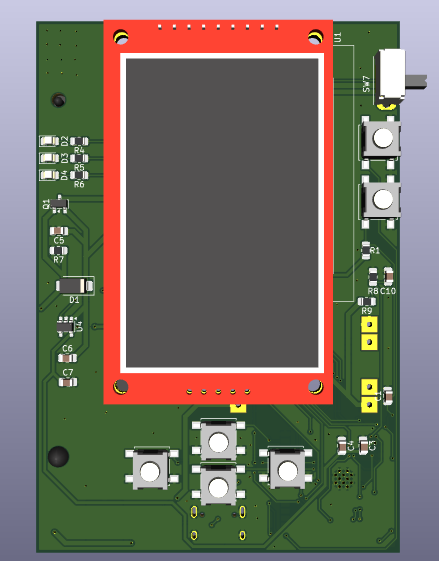
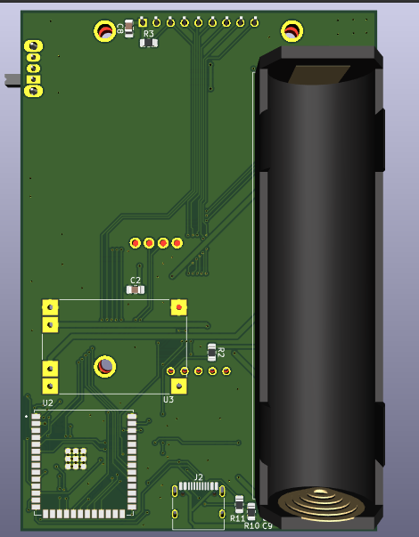
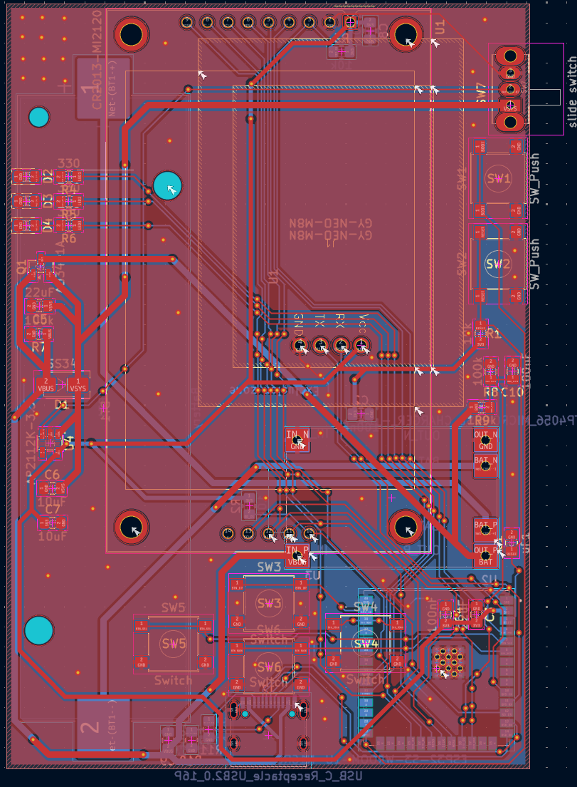
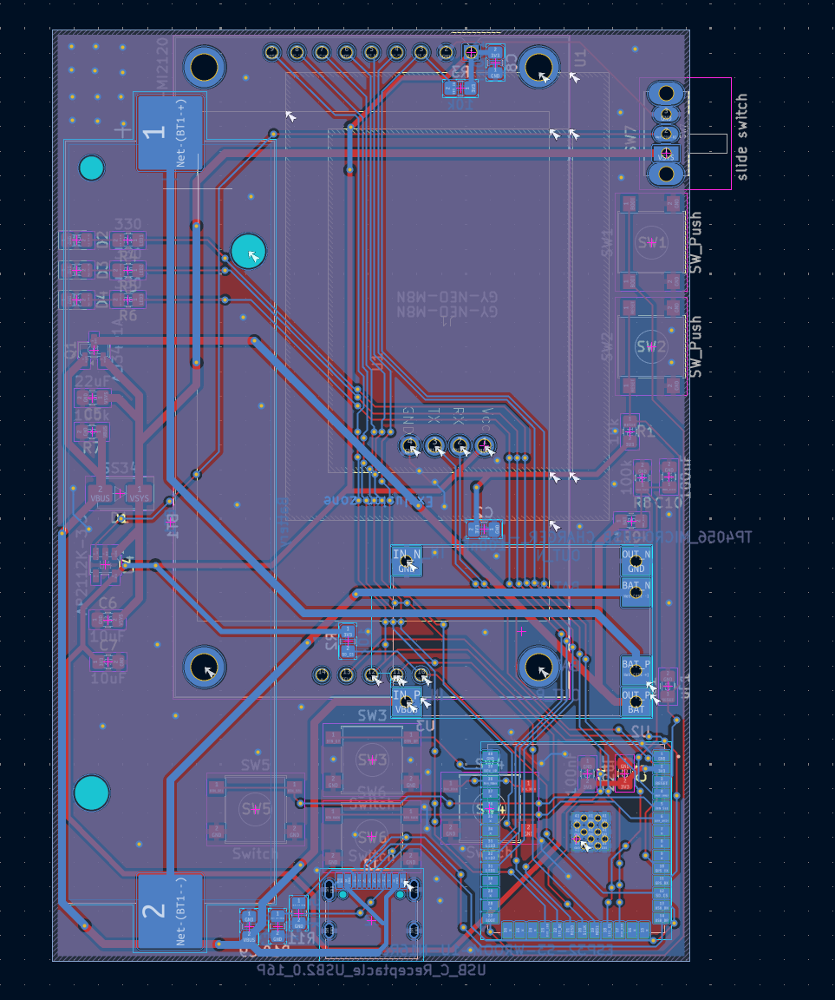
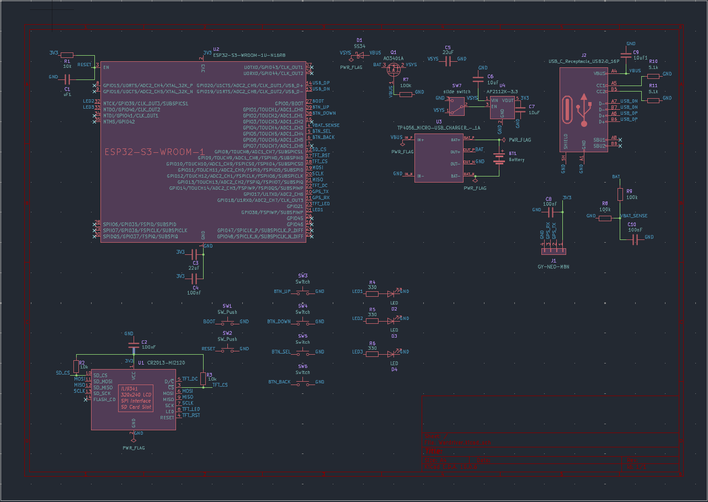

# Wardriver!

#

### wardriving (noun) - The act of searching for a Wi-Fi wireless network, usually from a moving vehicle, using a laptop or smartphone.
#

  
  

Hello yall! (My second README, have fun! <3) so this is a... wardriver! Well I like to call it a wi-fi/BLE scanner and monitor and I won't scan while from a moving vehicle but wardriver sounds cooler so yeah.
#
This is my second project which I actually did it all by myself (not unlike the software projects, let's not talk about those.)

This device scans wi-fi and bluetooth RFs and it also has GPS, and it uses the ESP32 Marauder (by justcallmekoko).

#
### This is the PCB 

  
  

you can find it in the repo files aswell (duh), along with the schematic, and all those files.

### This is the Schematic

#

#### I have also made an edit, which is on the *'doomscroller'* of Half-Life, as soon as I have a link (from anywhere) I will post it here. 

What else can I say, this project is a very interesting project and I am passionate on such things, on Radio Frequencies, scanning them, etc. and I have been wanting to make it for a long time. Its like when I think about it my heart starts racing with excitement! 

## And yes, of course, the BOM;
(BOM v1, I will cut costs to land under 65$, OR I will work more and make it fully finished for tier 3 of funding who knows :3)

|Part|Qty|Price|Link|
|---|---|---|---|
| ESP32-S3-WROOM-1U-N16R8 | 1 | $6.76/32.24 RON | https://www.digikey.com/en/products/detail/espressif-systems/ESP32-S3-WROOM-1U-N16R8/16162641 |
| 2.2" SPI TFT, ILI9341, 240×320, with microSD | 1 | $13.88/66.11 RON | https://www.amazon.com/Display-Module-240x320-ILI9341-Arduino/dp/B0F9XXV4V7?currency=USD |
| GY-NEO-M8N GPS module + patch antenna | 1 | $17.45 | https://www.addicore.com/products/neo-m8n-gps-gnss-module-with-eeprom |
| TP4056 Lithium Battery Charger Module with Dual Protection (USB-C) | 1 | $4.95/23.58 RON | https://www.crcibernetica.com/tp4056-lithium-battery-charger-module-with-dual-protection-usb-c/ | 
| AP2112K-3.3 | 1 | $0.17/0.81 RON | https://www.lcsc.com/product-detail/C51118.html |
| A03401A | 1 | $0.52/2.48 RON| https://www.digikey.com/en/products/detail/alpha-omega-semiconductor-inc/AO3401A/1855773
| SS34 Schottky | 1 | $1.01/4.81 | https://www.digikey.com/en/products/detail/onsemi/SS34/1052384 |
| TYPE-C-31-M-12 | 1 | $0.19/0.90 RON | https://jlcpcb.com/partdetail/Korean_HropartsElec-TYPE_C_31_M12/ |
| Keystone 1042 18650 holder | 1 | $5.99/28.53 RON | https://www.digikey.com/en/products/detail/keystone-electronics/1042/2745668 | 
| B3S-1000 | 6(10 pack) | $4.24/20.20 RON| https://www.digikey.com/en/products/detail/aratas-formerly-omron-components/b3s-1000/20686
| slide switch, SPDT | 1 | $0.75/3.57RON | https://www.digikey.com/en/products/detail/c-k/OS102011MA1QN1/1981430 |
| LED 0805 | 3 | $0.38/1.81 RON | https://www.digikey.com/en/products/detail/visual-communications-company-vcc/LSM0805452V/10229619 | 
| 220 ohm resistor | 3 | $0.30/1.43 RON | https://www.digikey.com/en/products/detail/yageo/RC0805JR-07330RL/728311 |
| 10k ohm resistor | 3 | $0.33/1.57 RON | https://www.digikey.com/en/products/detail/vishay-dale/CRCW080510K0FKEAC/7928398 |
| 100k ohm resistor | 3 | $0.30/1.43 RON | https://www.digikey.com/en/products/detail/yageo/RC0805JR-07100KL/728239 |
| 5.1k ohm resistor | 2 | $0.2/0.95 RON | https://www.digikey.com/en/products/detail/yageo/RC0805JR-075K1L/728338 |
| 100nF capacitor | 4 | $0.72/3.43 RON | https://www.digikey.com/en/products/detail/kemet/C0805C104K5RACTU/411169
| 1uF capacitor | 1 | $0.67/3.19 RON | https://eu.mouser.com/en/ProductDetail/KYOCERA-AVX/KAF21KR71H105JU?qs=sGAEpiMZZMsh%252B1woXyUXjwCqkQtzlfA8HMiLPMH3N9o%3D |
| 10uF capacitor | 3 | $1.02/4.86 RON | https://www.digikey.com/en/products/detail/yageo/CC0805ZKY5V6BB106/2103093 |
| 22uF capacitor | 2 | $0.72/3.43 RON | https://www.digikey.com/en/products/detail/murata-electronics/GRM21BR61E226ME44L/4905535 |
| PCB from JLCPCB | 5 pack | $4.00/19.05 RON | N/A |
